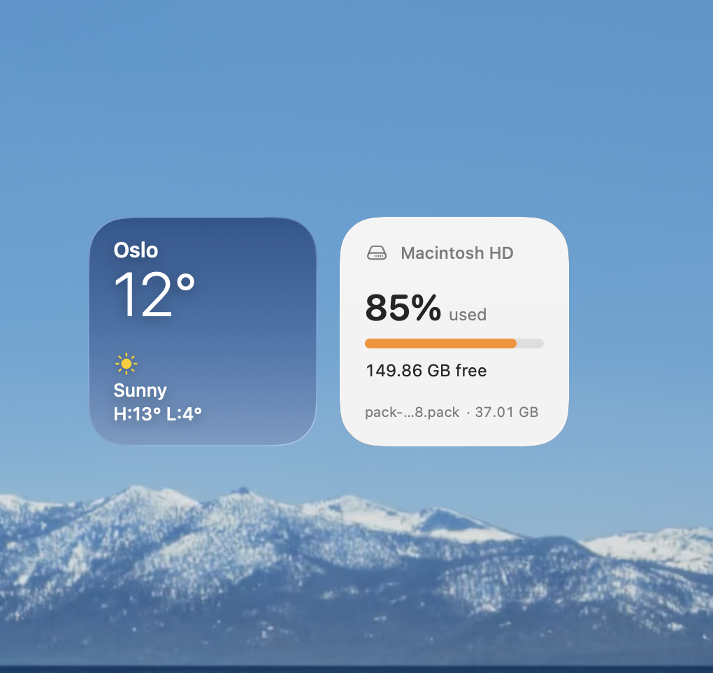
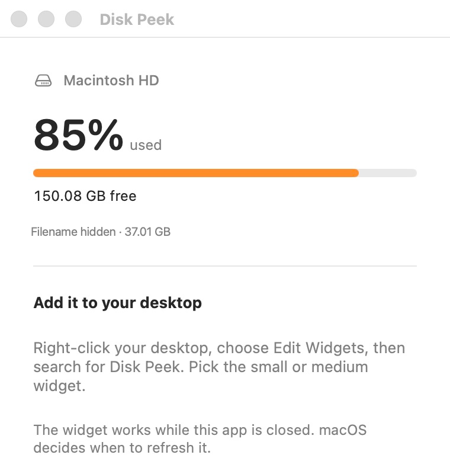

# Disk Peek

A small, native Mac desktop widget showing disk usage, free space, and the largest indexed file to inspect.

It uses WidgetKit, so placement, dragging, desktop reveal, and appearance work like Weather and other macOS widgets. The companion app can be closed after setup.



Actual desktop screenshot with Disk Peek beside Weather in full color.

## Setup

Requirements:

- An Apple silicon Mac running macOS 14 or later.
- Full Xcode with its command-line tools selected, not just the standalone Command Line Tools package. The project uses Swift 6, so use Xcode 16 or later.
- [XcodeGen](https://github.com/yonaskolb/XcodeGen). If Homebrew is available and permitted on your machine, install it with `brew install xcodegen`.
- Access to this repository through your GitHub account.

Build from source and install:

```bash
git clone https://github.com/shopify-playground/disk-peek.git
cd disk-peek
bash install.sh
```

The installer runs the tests, builds the app and widget, verifies their local signatures, and copies Disk Peek into your user Applications folder. It refuses to replace an existing installation.

Then right-click the desktop → **Edit Widgets** → **Disk Peek**, and add the small or medium widget. You can quit the companion app afterward.



Actual setup window, cropped to the setup instructions. The filename is redacted.

No paid Apple Developer account or App Store installation is needed for this local build. It is ad-hoc signed for local use, not notarized for downloaded-binary distribution. Company device policies still apply. These instructions do not disable Gatekeeper, remove quarantine attributes, or change security settings. If your device blocks the build or launch, use your approved support process.

## What it shows

- **Percent used and free space.** Reads capacity and available space from the volume containing your home folder. Usage is `(capacity − free) / capacity`; on APFS, this includes space used by the other volumes in the shared container. Purgeable space and snapshots can make System Settings report a different number.
- **Storage bar.** Orange at 80% used, red at 90%.
- **Largest file to inspect.** The companion app queries the existing Spotlight index for regular files of at least 100 MB in your home folder, then checks their current sizes. Hidden, protected, or unindexed files may be missing. The filename shortens in the middle so its size stays visible.

**Largest is not a deletion recommendation.** It could be a Git pack, virtual-machine disk, or another important file. File size is not guaranteed reclaimable space. Disk Peek never deletes, opens, or changes a candidate file. **Reveal in Finder** selects it for you to review.

## Refreshing

The widget requests a new disk reading after 15 minutes. macOS controls the actual schedule, so this is not a real-time monitor.

File searches run in the companion app, not the widget. Open Disk Peek for the initial search, then use **Rescan files** to update the result. Results older than 24 hours, future-dated results, or failed searches show **Find large files** instead of an old candidate. **Refresh widgets** requests an updated widget timeline.

The widget links to file review in the companion app. **Storage settings** is also available there.

## Privacy and permissions

- No network calls, analytics, accounts, or background service.
- No new index or recursive file-content scan. The companion uses macOS's existing Spotlight index and reads file metadata.
- No administrator permissions, Full Disk Access request, login item, or automatic deletion.
- The companion runs outside the App Sandbox and can inspect metadata accessible to the current user. It does not bypass macOS access controls.
- The widget is sandboxed. It has read-only access to Disk Peek's own preferences through Apple's documented shared-preference entitlement; it cannot scan your home folder. The saved result contains the candidate's path, size, and scan time, and stays on your Mac.

## Build and test without installing

```bash
bash build.sh
```

Output: `build/Xcode/Build/Products/Release/Disk Peek.app`.

The build regenerates `DiskPeek.xcodeproj` from `project.yml`. Tests cover capacity calculations and invalid readings; file-result encoding and freshness; and ranking with spaces, newlines, symlinks, directories, and missing files. The build also verifies the app and embedded extension signatures and property lists.

Verified locally on macOS 26.6.2, Apple silicon, with Xcode 26.5 and Swift 6.3.2. The small and medium widgets were checked in the native gallery; the small widget, file row, and companion's Finder reveal were checked on a desktop. Older supported macOS versions have not been tested.

## Updating or removing

To update, quit Disk Peek, move the existing app somewhere safe, then run `bash install.sh` from the updated checkout. Do not run old and new copies together. If macOS retains an old widget rendering, try **Refresh widgets** in the companion app, or remove and re-add the desktop widget.

To uninstall, remove the desktop widget, quit Disk Peek, and move the app from your user Applications folder to Trash. There is no background service or login item to remove. Its local preferences can remain without running anything.
